# BookingDesk

**A multi-business appointment booking platform.** Any business (salon, clinic, gym, photographer, tuition class...) registers itself and gets its own booking page, owner dashboard, billing and private data. Customers find businesses on a map and book online.

**Live demo:** https://bookingdesk.onrender.com  
**Demo business:** https://bookingdesk.onrender.com/b/blush-bloom

| Role | Phone | Password |
| --- | --- | --- |
| Owner | `9000000001` | `123456` |
| Customer | `9000000003` | `123456` |
| Team member | `9000000021` | `123456` |

On the login page, "Try the demo" signs you in with one click. The demo runs on free hosting: the first load can take 30-60 seconds, and demo data resets when the server restarts.

## Screenshots

| Platform home | Find a business (map) |
| --- | --- |
| 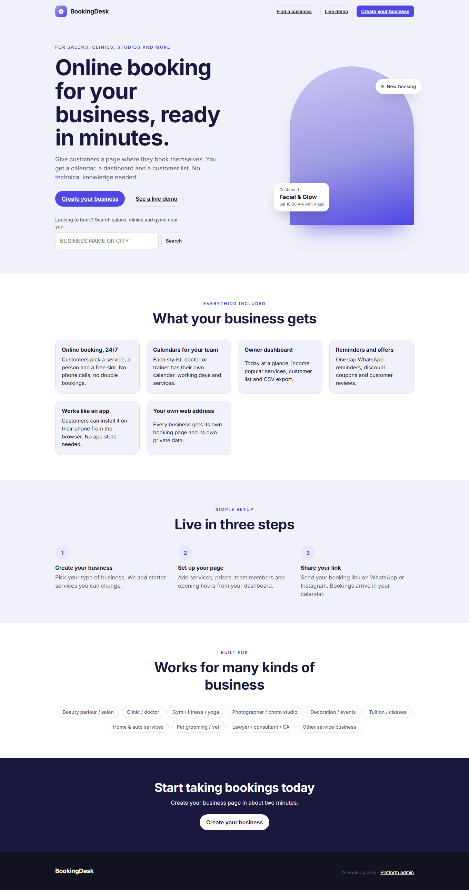 | 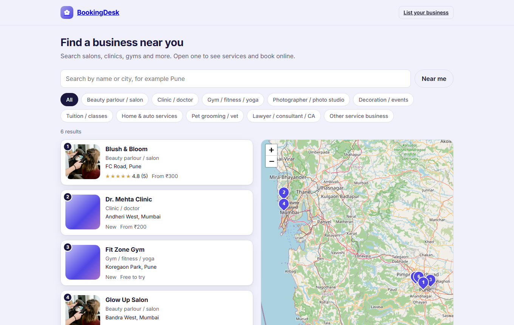 |

| A business page (parlour) | Customer booking |
| --- | --- |
| 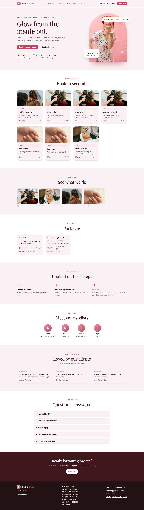 | 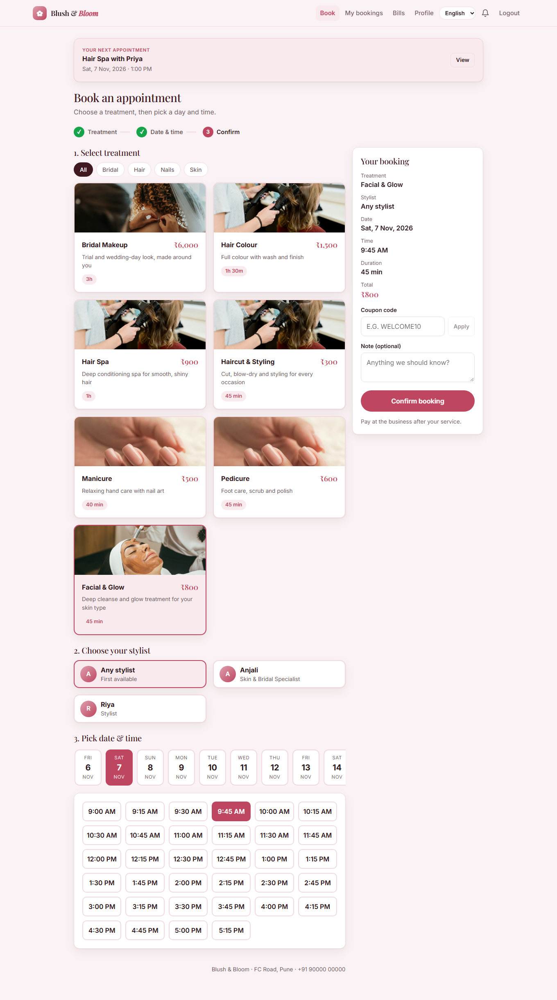 |

| Owner dashboard | Calendar |
| --- | --- |
| 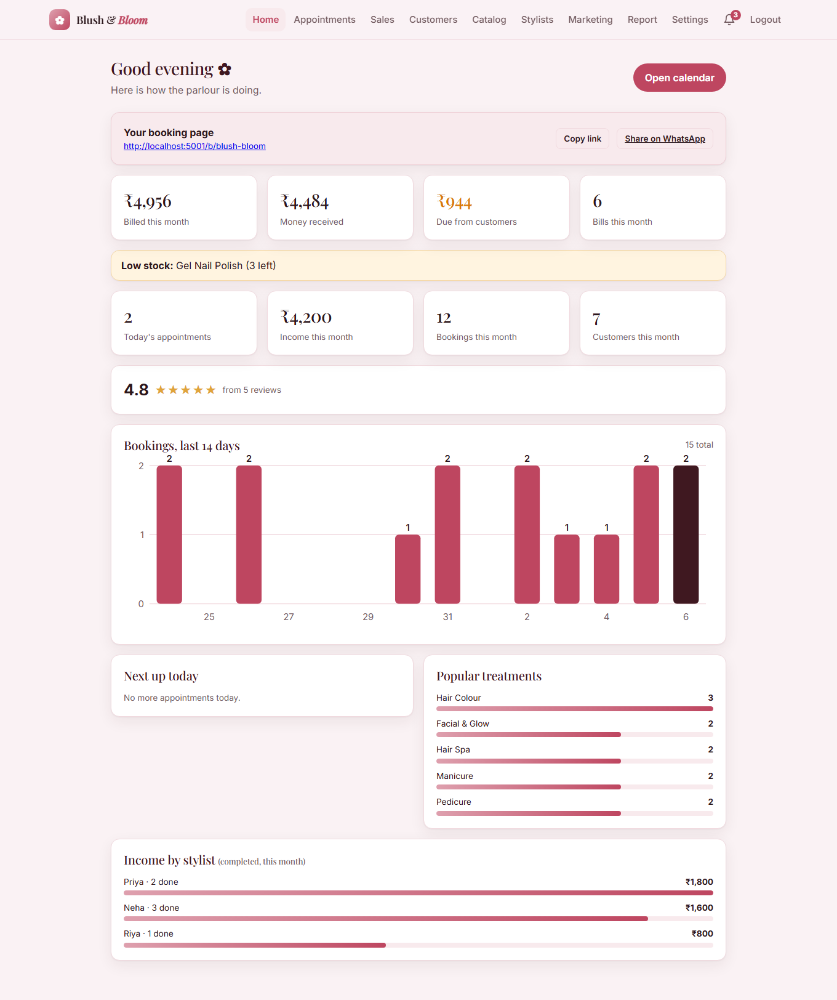 | 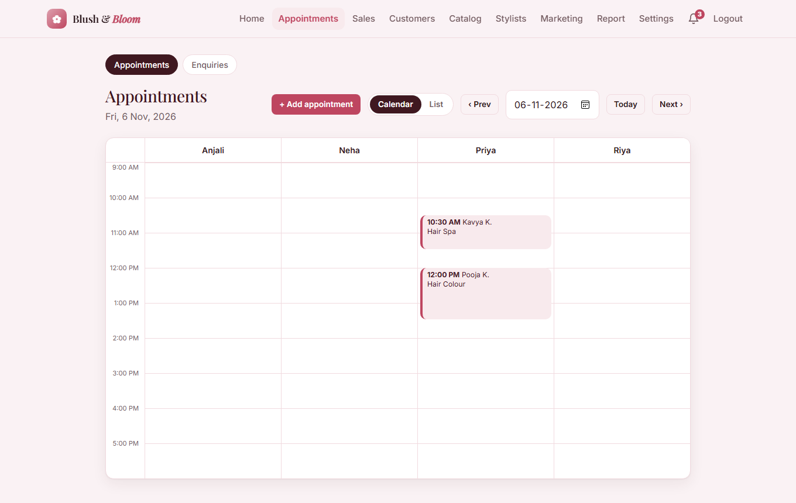 |

| Bill with UPI QR | Report and commission |
| --- | --- |
| 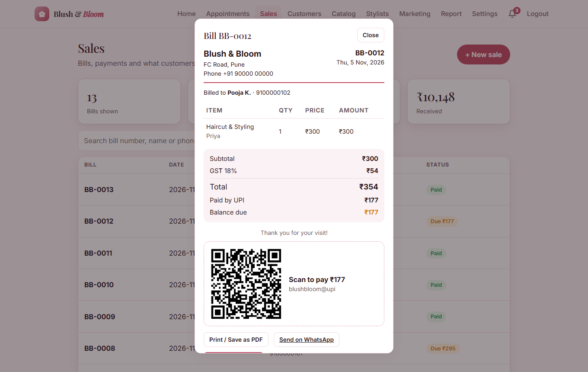 | 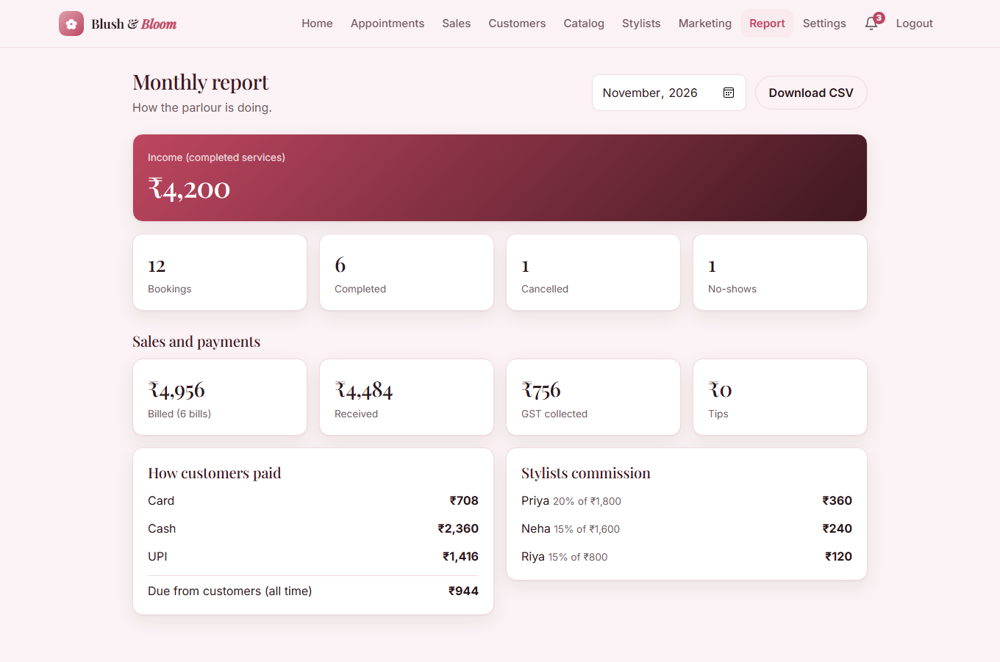 |

| Team and commission | Photographer page (full-day services) |
| --- | --- |
| 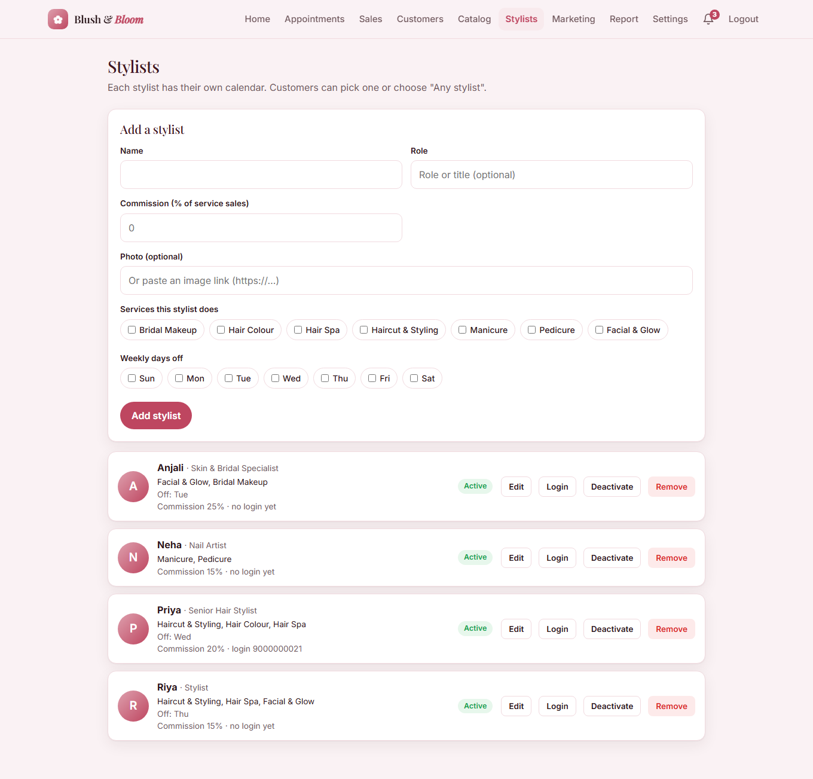 | 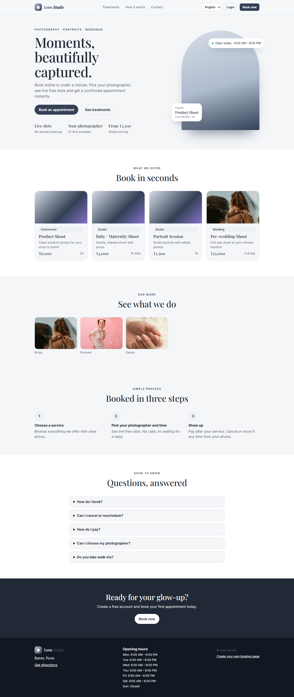 |

| Mobile: landing | Mobile: booking |
| --- | --- |
| 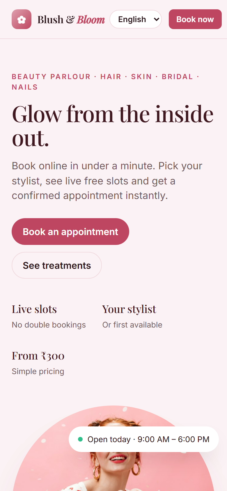 | 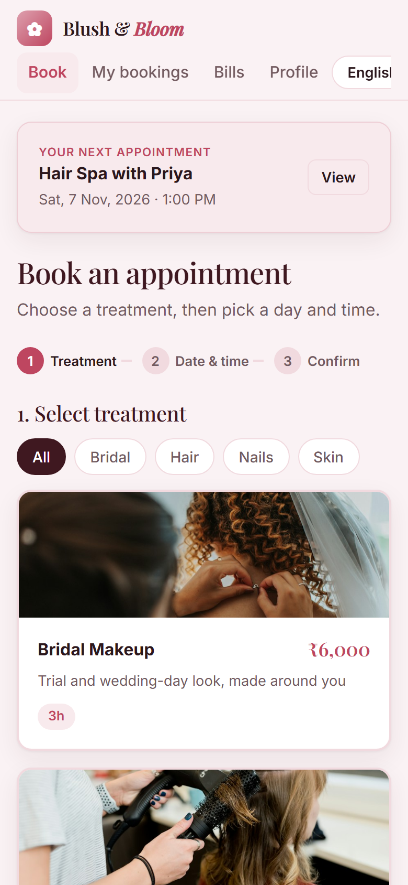 |

## Why I built it

Small businesses in India still take bookings on phone calls and in paper diaries. Existing apps are English-only, complex or expensive for a small parlour. BookingDesk is one platform where an owner signs up in two minutes, shares a link on WhatsApp, and gets a calendar, bills and a customer list.

## What it does

**For the business owner**
- Self-service sign-up with starter services for the type of business (beauty, clinic, fitness, photographer, events, tuition, home services, pet care, professional)
- Dashboard: today, income, 14-day chart, popular services, income per team member, ratings
- Calendar view (one column per team member), walk-in bookings, one-tap WhatsApp reminders
- **Billing:** bills with GST, discount and tip; print / save as PDF; **UPI QR code**; part payments; customer account (khata) showing what each customer owes
- **Packages / memberships** (for example "Facial x5"), **products with stock**, low-stock alerts
- **Team logins with commission:** a team member sees only their own schedule and earnings
- Services priced by **time slot, full day, or quote request** (decoration, wedding shoots), with venue and guest count
- Marketing: campaigns to groups (inactive, birthday, top customers), coupons, message outbox
- Gallery, location with a map pin, brand colour and font, cancellation policy, CSV export, calendar link for Google / Apple calendar

**For customers**
- Find businesses at `/explore`: search by name or city, filter by type, **"Near me"**, list and map (OpenStreetMap)
- Pick a service, a team member (or "any") and a live free slot; coupons; reschedule, cancel, rate a visit
- See bills and remaining package sessions; forgot password with a one-time code
- Each business installs as its own phone app (PWA)

**For the platform operator**
- Platform admin panel: all businesses, totals, suspend / activate
- **Single-business mode:** set `SINGLE_BUSINESS=<slug>` and the same code serves one business at `/` under its own domain

## Engineering highlights

- **Multi-tenancy:** every table is scoped by `business_id`; a login token only works inside the business that issued it. Covered by isolation tests (another business's token, service or booking id never works).
- **No double booking:** availability is computed per team member from opening hours, holidays, days off and existing bookings; the check and insert run in one synchronous step.
- **Money correctness:** prices are stored per booking and per bill, so coupons and later price changes never rewrite history. Checkout is a transaction: if any line fails (for example not enough stock) nothing is saved. Packages cover the GST on their service.
- **Security basics:** bcrypt + JWT, role checks (customer / team / owner / platform), rate limits on login and sign-up, input validation, secret calendar links, one-time codes stored hashed with attempt limits, CSV formula-injection guard.
- **Messaging without lock-in:** reminders, campaigns and codes go to an outbox and are posted to any provider through a webhook (`MESSAGE_WEBHOOK_URL`). Without a provider they are recorded as "test mode", never silently dropped.
- **Theming:** one brand colour produces a whole palette whose contrast is kept readable (checked against WCAG 4.5:1).
- **Tests:** 33 automated API tests (`cd backend && npm test`), plus a UI smoke test that renders every screen for each kind of user.

**Stack:** React 19 + Vite, Node 22, Express 5, SQLite (`node:sqlite`), JWT, Leaflet / OpenStreetMap, `qrcode`.

## Run locally

```bash
cd backend && npm install && npm run seed && npm start   # http://localhost:5001
cd frontend && npm install && npm run dev                # http://localhost:5174 (proxies /api)
```

`cd frontend && npm run build` makes the backend serve the website too (one server, one address). Platform admin at `/platform`: `9999999999 / 123456` (development only).

## Addresses

| Address | What |
| --- | --- |
| `/` | Product home page |
| `/explore` | Find a business: search, near me, map |
| `/signup` | A business owner registers |
| `/b/<business>` | That business: public page, customer app, owner and team apps |
| `/platform` | Platform admin |

## Settings (environment variables)

| Variable | Meaning |
| --- | --- |
| `JWT_SECRET` | **Required in production.** Long random string that signs logins |
| `PLATFORM_PHONE`, `PLATFORM_PASSWORD` | Login for `/platform`, created by `npm run seed` |
| `DB_FILE` | Where the SQLite database lives, for example `/var/data/booking.db` |
| `SINGLE_BUSINESS` | Optional. Serve only this business (slug) at `/` |
| `MESSAGE_WEBHOOK_URL`, `MESSAGE_WEBHOOK_TOKEN` | Optional. Where reminders and codes are posted to be sent by WhatsApp / SMS |
| `TZ` | Time zone of the customers, for example `Asia/Kolkata`. Set it on the server |
| `AUTO_SEED=1` | Re-creates the demo businesses on every start (free hosting that resets its disk) |
| `NODE_ENV=production` | Turns off development demo logins and fake code display |
| `PORT` | Port (default 5001) |

## Hosting

**Demo (free): Render.** New > Blueprint > pick the repo (`render.yaml`). The free plan sleeps when idle and its disk resets on restart, so registered businesses are lost. Use it for the demo only.

**Real customers: a VPS or a paid plan with a persistent disk.** All data is one SQLite file, so the disk must survive restarts.

1. Linux server with Node 22 and a domain name.
2. `cd frontend && npm ci && npm run build` then `cd ../backend && npm ci`.
3. Run with a process manager (systemd or pm2) and the variables above, then `npm run seed` once and `node src/server.js`.
4. Put Caddy or Nginx in front for HTTPS (needed to install the phone app).
5. **Back up the database file every day.**

## Honest limits

- Reminders, campaigns and password-reset codes are **recorded, not delivered**, until a WhatsApp / SMS provider is connected through the webhook. Online card payment is not included; UPI is shown as a QR code and the owner marks it received.
- Marathi and Hindi: the language switcher and text lookup are built, but the translation files are still empty, so screens show English.
- SQLite suits a small number of businesses; move to PostgreSQL for scale. Photos are chosen from a gallery or pasted as links (no upload storage yet). No subscription billing or custom domain per business yet.
- Maps and address search use free OpenStreetMap services, fine for light use.

## Credits

Photos from Unsplash (free licence): Look Studio, Kulor Salon, Rosa Rafael, Nina Mercado, Chelson Tamares.
